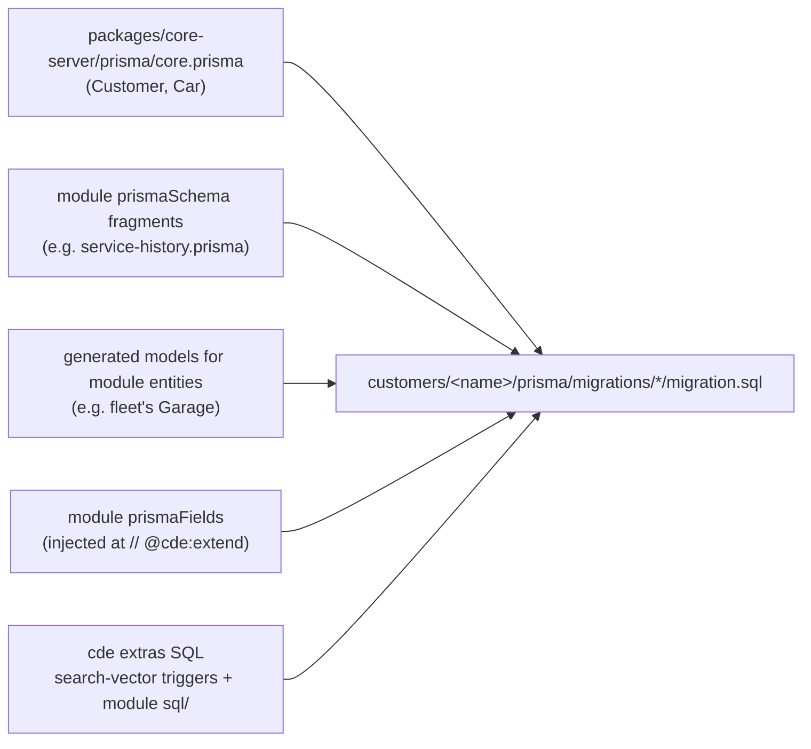
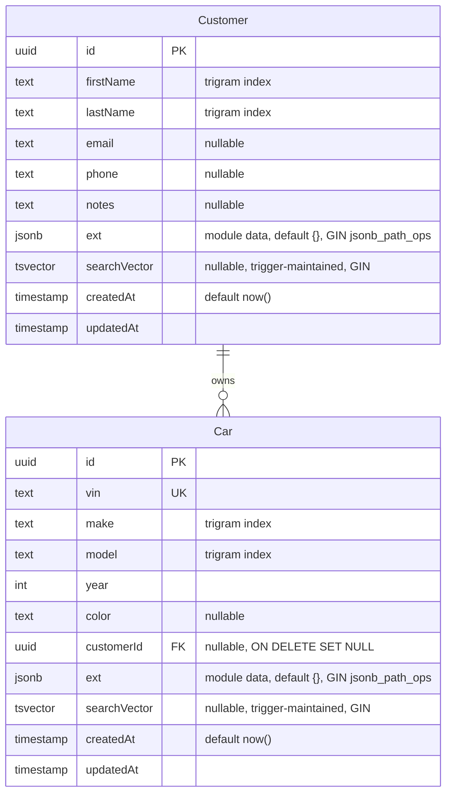
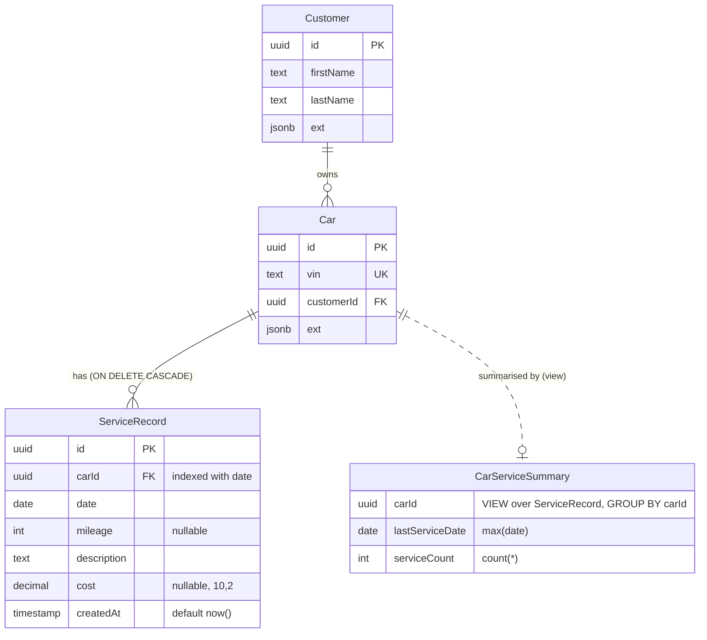
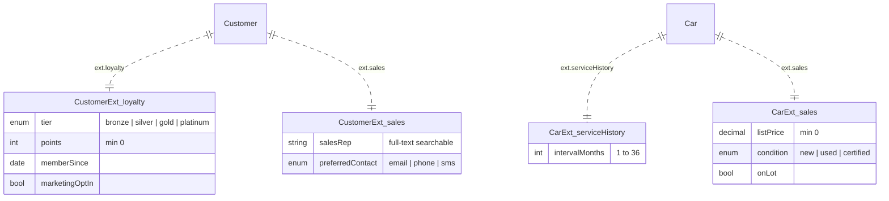
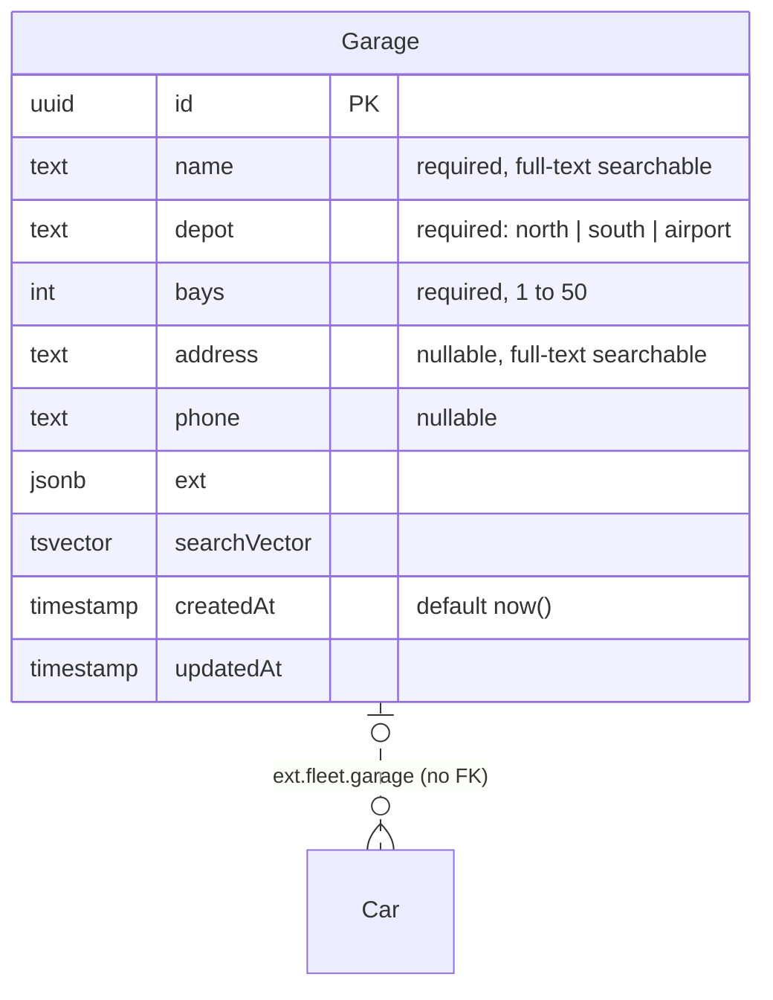
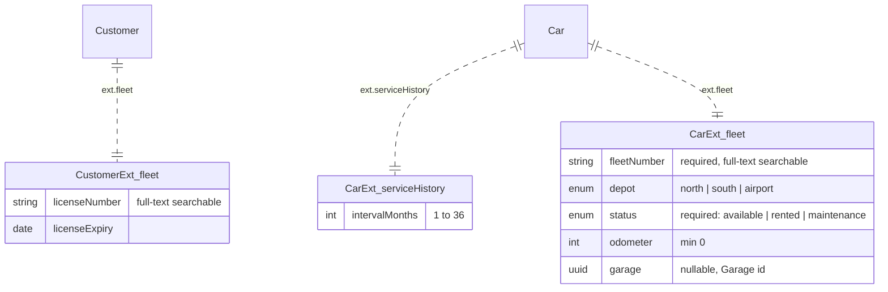

# Database Schema

Every customer install gets its own PostgreSQL database. The schema is assembled at build time by `@cde/assembler`:

There are three ways a module adds data:

- **Module entities**: a module can declare a whole new entity under `entities`. The assembler generates its table from the field declarations, with the same shape as the core tables (`id`, columns, `ext`, `searchVector`, timestamps) and a `// @cde:extend` marker so other modules can extend it. It gets the generic API, search and UI. Reference columns are indexed uuids with no foreign key; the API checks them. Only `fleet` (`Garage`) does this today.
- **Real tables/columns**: a module can ship a Prisma fragment (`prismaSchema`), back-relations (`prismaFields`) and raw SQL (`sql`). Only `service-history` does this today.
- **JSONB fields**: everything declared under `extends.<Entity>.fields` lives in the entity's `ext` column, namespaced by module name: `{ "<module>": { "<field>": value } }`. No migration needed; validation, filters and form editors are generated from the declaration.

## Core schema (`bare`)

The baseline every install has. This is the entire schema for `bare`.

## With `service-history` (`acme`, `globex`)

`service-history` adds a real table, a back-relation on `Car`, and a view.

(`Customer` and `Car` are abbreviated here; their columns are identical to the core schema.)

The module also exposes computed `Car` fields that aren't stored: `lastServiceDate` and `serviceCount` come from `CarServiceSummary`, and `due` is derived from those plus `ext.serviceHistory.intervalMonths` (default 12).

## JSONB `ext` contents per customer

These diagrams show the logical shape of the `ext` column. The `CustomerExt_*` / `CarExt_*` boxes are **not tables**: each is a key inside the parent row's `ext` JSONB.

### `acme`: loyalty + service-history + sales

### `globex`: service-history + fleet

`globex` relabels `Customer` as "Renter" in the UI; the table is still `Customer`.

`fleet` also declares the `Garage` entity, which gets a real table. A car is kept at no garage or one:
`ext.fleet.garage` holds the garage id. It lives in JSONB, so there is no foreign key; the API checks it exists,
and the fleet module refuses to delete a garage that still has cars.

## Indexes, triggers and views

| Object | Kind | Installs | Notes |
| --- | --- | --- | --- |
| `pg_trgm` | extension | all | Needed for the trigram indexes |
| `Customer_ext_idx`, `Car_ext_idx` | GIN (`jsonb_path_ops`) | all | Containment queries on `ext` |
| `Customer_searchVector_idx`, `Car_searchVector_idx` | GIN | all | Full-text search |
| `Customer_firstName_trgm_idx`, `Customer_lastName_trgm_idx` | GIN (`gin_trgm_ops`) | all | Fuzzy name matching |
| `Car_make_trgm_idx`, `Car_model_trgm_idx` | GIN (`gin_trgm_ops`) | all | Fuzzy make/model matching |
| `Car_vin_key` | unique | all | |
| `Car_customerId_idx` | btree | all | |
| `ServiceRecord_carId_date_idx` | btree | acme, globex | |
| `Garage_ext_idx`, `Garage_searchVector_idx` | GIN | globex | Generated with the `Garage` model |
| `cde_Customer_search_vector`, `cde_Car_search_vector` | `BEFORE INSERT OR UPDATE` trigger | all | Generated per install (see below) |
| `cde_Garage_search_vector` | `BEFORE INSERT OR UPDATE` trigger | globex | name, address |
| `CarServiceSummary` | view | acme, globex | From `modules/service-history/sql/` |

The search-vector triggers are generated from every field marked `searchable: 'text'`, so their contents differ per install:

| Install | `Customer.searchVector` | `Car.searchVector` |
| --- | --- | --- |
| bare | firstName, lastName, email, phone, notes | vin, make, model |
| acme | … + `ext.sales.salesRep` | vin, make, model |
| globex | … + `ext.fleet.licenseNumber` | vin, make, model, `ext.fleet.fleetNumber` |
