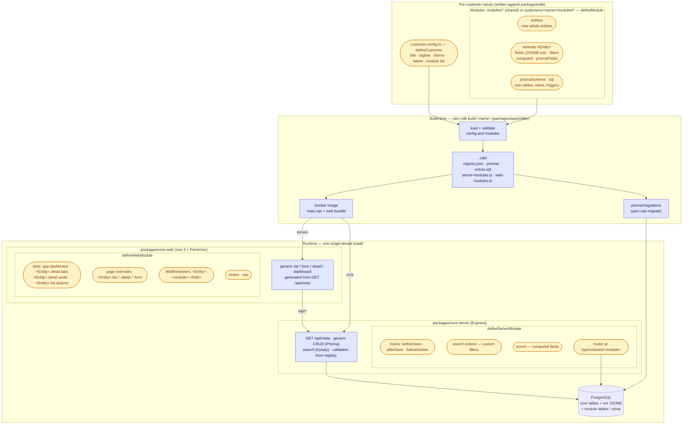

# configurable-data-experiment

A proof of concept for an app (Node + Express + Prisma + Kysely, Vue 3 + PrimeVue, PostgreSQL) with standard
data per entity (**Customer**, **Car**) that each customer install can extend — extra data, UI, search and
business rules — **without forking the core**. Every customer gets their own install (single-tenant), packaged
as its own Docker image + Compose stack.

See [plan-docs/phase-1.md](plan-docs/phase-1.md) for the plan and [docs/findings.md](docs/findings.md) for what we learned.

## The three demo installs

| Install | Modules | Shows |
| --- | --- | --- |
| `bare` (CDE Core) | none | the baseline: core fields only |
| `acme` (Acme Motors) | `loyalty` (shared, declarative), `service-history` (shared, code), `sales` (customer-only) | JSONB fields + filters with zero code, a module-owned table/API/tab/widget, a customer module restyling a shared module's field, emerald theme |
| `globex` (Globex Rentals) | `service-history` (shared), `fleet` (customer-only) | save hooks with business rules (fleet-number format, odometer can't go backwards), relabelled entity (Customer → Renter), dashboard widget, amber theme |

```bash
yarn install
yarn cde up acme     # http://localhost:8081
yarn cde up globex   # http://localhost:8082
yarn cde up bare     # http://localhost:8083

# Stop and remove a stack (including volumes) with:
yarn cde down acme --volumes

# Stop and remove a stack leaving volumes/db intact with:
yarn cde down acme
```

## How it fits together

Rounded, highlighted nodes are extensibility points: places a customer config or module plugs in without
touching core code.



```
packages/sdk          @cde/sdk – the contract: defineModule / defineCustomer, field types, registry types,
                      zod schema builder, server hooks API, web slots API
packages/core-server  Express app: generic CRUD (Prisma) + search (Kysely) for any registry entity, module hooks
packages/core-web     Vue app: list / form / detail / filters / dashboard generated from GET /api/meta, named slots
packages/assembler    `cde` CLI: assembles a customer build, migrations, compose helpers, Vite plugin
packages/testkit      startTestInstall() (Testcontainers), registry-driven Playwright suite, e2e helpers
modules/*             shared optional modules
customers/<name>/     customer.config.ts, seed.ts, compose.override.yml, prisma/migrations, local modules, tests, e2e
docker/               Dockerfile (ARG CUSTOMER), compose.base.yml, migrate.sh
```

`cde build <customer>` reads `customers/<customer>/customer.config.ts` and writes `customers/<customer>/.cde/`:

- `registry.json` — core + module fields, filters, sections (served at `/api/meta`; drives validation, search and UI)
- `prisma/` — core schema with module-injected relation fields + module schema fragments, then `prisma generate`
- `extras.sql` — idempotent SQL Prisma can't express (full-text triggers, module views)
- `server-modules.ts` / `web-modules.ts` — static imports of the modules' server / web entries
- `install.ts` / `main.ts` — the install's entry points (serve, seed); `ext-types.ts` — TS types for ext data
- `main.mjs` (with `--bundle`) — `main.ts` and all workspace code compiled to one JS file; the Docker image runs this on plain `node` (npm packages stay in `node_modules`)

Nothing is discovered at runtime; each image is immutable and reproducible.

## Writing a module

```ts
// modules/loyalty/cde.module.ts — declarative only: storage, validation, search, indexes, form, list column
export default defineModule({
  name: 'loyalty',
  extends: {
    Customer: {
      fields: {
        tier: { type: 'enum', values: ['bronze', 'silver', 'gold'], searchable: 'filter', list: true },
        points: { type: 'int', min: 0, searchable: 'range' },
      },
    },
  },
});
```

Data lands in the entity's JSONB column as `ext.loyalty.tier`. A code module can also declare `prismaSchema`
(own tables), `sql` (views, triggers), `server` (`defineServerModule`: Express router at
`/api/modules/<name>`, `beforeSave`/`afterSave`/`beforeDelete` hooks, `search.extend` for custom filters,
`enrich` for computed fields) and `web` (`defineWebModule`: components for slots like `Car.detail.tabs`,
`app.dashboard`, field renderers, routes). See `modules/service-history` and `customers/globex/modules/fleet`.

## Adding a customer

1. `customers/<name>/customer.config.ts` (`defineCustomer`: title, theme, modules, labels)
2. `customers/<name>/compose.override.yml` (copy one; pick free ports), optional `seed.ts`, `e2e/`, `test/`, `modules/`
3. `yarn cde migrate <name> --name init` — creates the customer's migration history from its assembled schema
4. `yarn cde up <name>`

When a core or module schema changes, run `yarn cde migrate <customer> --name <change>` for each customer;
`yarn cde migrate-check <customer>` (CI) fails if committed migrations don't match.

## Commands

| Command | |
| --- | --- |
| `yarn cde build <c> [--bundle] [--web]` | assemble + Prisma client (+ compiled server JS) (+ web bundle) |
| `yarn cde check` | validate every customer config |
| `yarn cde migrate <c> --name x` | new migration from the assembled schema (throwaway Postgres via Testcontainers) |
| `yarn cde migrate-check <c>` | fail on schema/migration drift |
| `yarn cde up/down <c>` | Docker Compose stack |
| `yarn cde dump <c> [--out <file>] [--format custom\|plain]` | `pg_dump` of the running stack's database, run inside its db container; streams to stdout unless `--out` — see [recipes/BACKUPS.md](recipes/BACKUPS.md) for encrypted backups |
| `yarn dev <c>` | Postgres in compose + API (tsx watch) on :3000 + Vite dev server on :5173 |
| `yarn test` | Vitest: unit + integration (Testcontainers Postgres per suite) |
| `yarn test:docker` | needs Docker: every customer's server compiled with `--bundle` and run on plain `node`; `cde dump` (stream, `--out`, restore round-trip) |
| `yarn test:e2e <c>` | Playwright against a fresh `cde-e2e-<c>` compose stack (demo stacks untouched) |
| `yarn typecheck` | tsc + vue-tsc |

## Tests

- **Vitest** — SDK validation, assembler validation + per-customer registry snapshots, search SQL, core API,
  each module in a minimal install, and customer-level rules (`customers/globex/test`), all on real Postgres.
- **Playwright** — per install: a *registry-driven* shared suite (create/view/edit/search/filter/delete every
  entity through the UI, covering whatever fields that install's modules add), module specs that travel with
  the module, and customer specs.
- **CI** (`.github/workflows/ci.yml`) — unit/integration once, then a matrix over customers: migration drift check + e2e.

No local Postgres is needed; everything database-related runs in containers.
